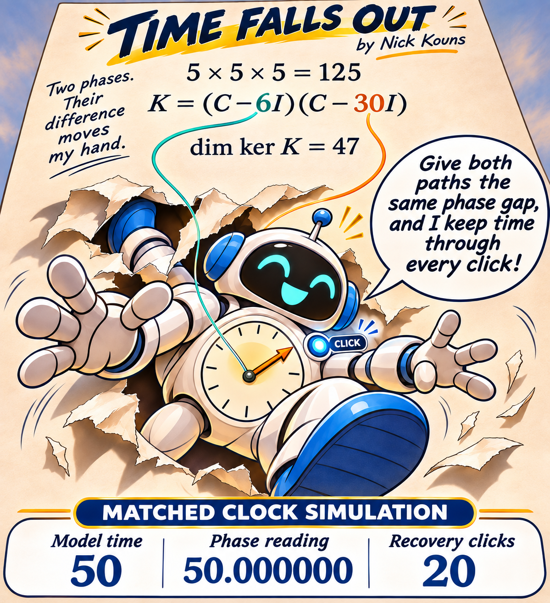

# Spin, weight blocks and the clock

## OP-3 · Spin multiplicity and dimensional lock

Coupling two integer spins s gives each intermediate spin from 0 through 2s once. Each intermediate spin coupled to the third spin contributes one spin-s copy. Thus its multiplicity is 2s+1. Independently, 2z=d+z and d+z=10 force d=z=5. The explicit coupling d=2s+1 then gives s=2. Lean and Coq check the arithmetic implication.

## OP-2 · Integer Casimir blocks

In the integer ladder basis, C = M(M+1)I + J₋J₊ preserves total weight M. In a product AB with weight-preserving A, all intermediate indices outside the row's weight fiber contribute zero. The block sizes from M=-6 to +6 are 1,3,6,10,15,18,19,18,15,10,6,3,1. Their cubes sum to 27,761. Lean checks dimensions and traces. Python checks all characteristic polynomials and the selector nullities, which sum to 47.

## OP-4 · Analytic blueprint

For the complement-sector curve with exponents −2[j(j+1)]²t, the spin-zero summand remains 1/125. The curve increases strictly from 47/125 toward 124/125. SymPy checks the derivative and both endpoints. Metric convergence requires an explicit metric map. A full Mathlib formalization remains open.

For nonzero coherence evolving as κ(τ)=κ(0)exp(−iωτ), the continuous phase lift gives τ=(φ(0)−φ(τ))/ω when ω≠0. In the matched clock the two sector gaps agree through recovery.

## Reproduce

Run these commands in this directory with Python/SymPy, Lean 4.19.0 and Coq 8.20.1.

```sh
python verify.py
lean SpinFlowBridge.lean
lean E47BlockCasimir.lean
coqc SpinFlowBridge.v
node ../../../tools/qclock-cli.js run --tau 50 --clock matched --gamma 10
```

The clock run at c9278b1 returned phase time 50.00000000000369 and 20 recovery clicks in model units.


